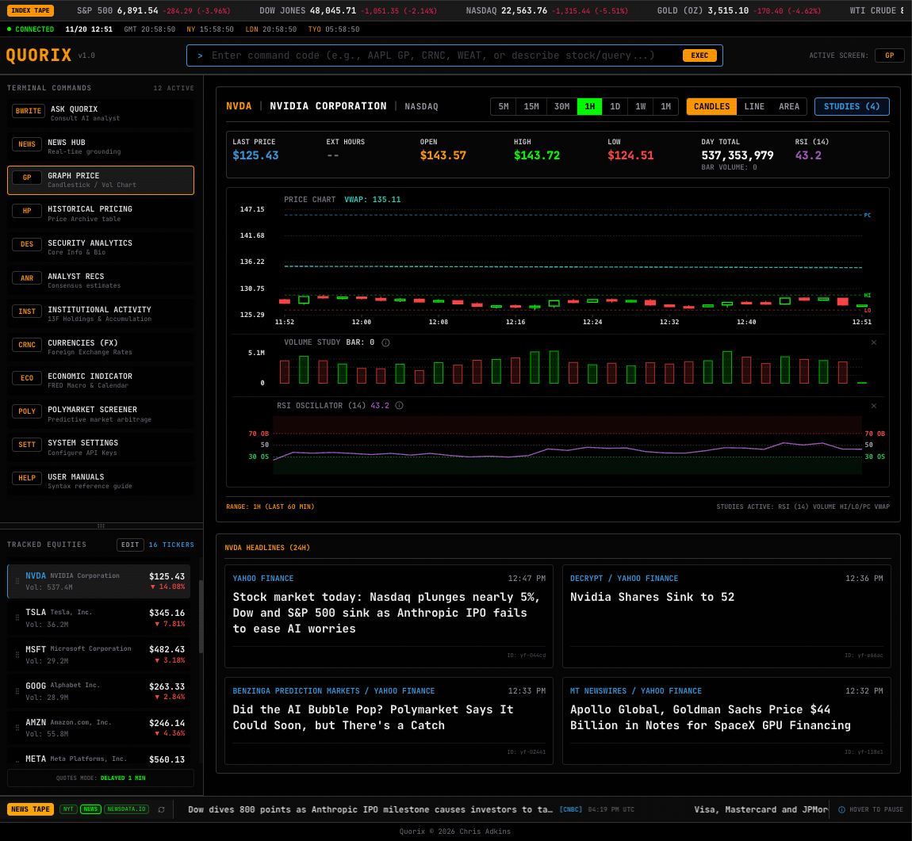

# QUORIX Terminal

A retro CRT-styled financial market terminal built with React, TypeScript, Tailwind CSS, and an Express backend proxy. QUORIX integrates live equity/index market data, Federal Reserve Economic Data (FRED), Polymarket prediction markets, institutional ownership data, multi-source financial news, portfolio risk analysis, correlation analysis, and AI-assisted research grounded with live market context. Company logos appear alongside equity ticker symbols across several primary screens.

---

## Quick Start

### Prerequisites
- **Node.js** (v20+ recommended)
- **npm** (or `bun`)

### Setup & Run
```bash
# 1. Install dependencies
npm install

# 2. Configure environment file (optional for basic features)
cp .env.example .env

# 3. Launch development server
npm run dev
```

Open **http://localhost:3000** in your browser.

*Note: Real-time equity quotes, candlestick charts, Polymarket prediction odds, and SEC Form 3/4/5 insider reports work immediately out of the box without any API keys.*

---

## Features

The QUORIX terminal interface is organized into 14 dedicated modules, accessible directly via the top command prompt or from the left sidebar navigation:

| Command | Module | Description |
|---|---|---|
| `ASK` | [Ask QUORIX](docs/modules.md#1-ask-quorix-ask) | AI financial and macro analyst assistant powered by Google Gemini with live Search Grounding (legacy alias: `BWRITE`). |
| `NEWS` | [News Hub](docs/modules.md#2-news-hub-news) | Multi-source real-time financial news stream combining Yahoo Finance, NYT Business, NewsAPI, and NewsData.io. |
| `GP` | [Graph Price](docs/modules.md#3-graph-price-gp) | Interactive OHLCV charts with technical studies, company logos, and SEC Forms 3, 4, and 5 insider ownership reports. |
| `CORR` | [Correlation Analyzer](docs/modules.md#4-correlation-analyzer-corr) | Multi-asset correlation matrix and pairwise relationship analyzer to evaluate co-movement and diversification boundaries. |
| `PRM` | [Portfolio Risk Monitor](docs/modules.md#5-portfolio-risk-monitor-prm) | Institutional-grade portfolio risk decomposition, GICS sector/industry exposure, and downside shock stress-testing. |
| `HP` | [Historical Pricing](docs/modules.md#6-historical-pricing-hp) | Tabular archive of historical OHLCV pricing, intraday bars, company logos, volume analysis, and earnings reporting dates. |
| `DES` | [Security Analytics](docs/modules.md#7-security-analytics-des) | Corporate bio and fundamentals with company logo, fixed header, quote matrix strip, and structured financial metrics. |
| `ANR` | [Analyst Recs](docs/modules.md#8-analyst-recs-anr) | Street consensus ratings, company logo, structured breakdown table, and 12-month analyst price target distributions. |
| `INST` | [Institutional Activity](docs/modules.md#9-institutional-activity-monitor-inst) | Form 13F ownership analytics via 3spread, 48px company logo, position changes, multi-period accumulation, manager profiles, and House Congressional Trading feed (`CONGRESS` tab; House PTRs only under Title I Ethics in Government Act, personal non-commercial research). |
| `CRNC` | [Currencies FX](docs/modules.md#10-currencies-fx-crnc) | Foreign exchange intelligence and cross-rates powered by St. Louis Fed FRED H.10 daily currency series. |
| `ECO` | [Economic Indicator](docs/modules.md#11-economic-indicator-eco) | Macroeconomic dashboard tracking GDP, CPI, PCE, unemployment, Fed Funds, Treasury yields, and FOMC calendar via FRED. |
| `POLY` | [Polymarket Screener](docs/modules.md#12-polymarket-screener-poly) | Real-time prediction market event screener tracking probabilities, volume, liquidity, and spreads via Polymarket Gamma API. |
| `SETT` | [System Settings](docs/modules.md#13-system-settings-sett) | Terminal configuration workspace for managing session API credentials at runtime and verifying masked status indicators. |
| `HELP` | [User Manual](docs/modules.md#14-user-manual-help) | Built-in CLI reference guide, navigation shortcuts, syntax rules, and terminal capability documentation. |

---

## Terminal Commands

Enter any command into the top command prompt (`>`) and press **Enter** or click **EXEC**. You can also click shortcuts directly in the left sidebar.

| Command | Left Sidebar Module | Description |
| --- | --- | --- |
| `ASK` | Ask QUORIX | AI financial and macro analyst with Search Grounding |
| `NEWS` | News Hub | Multi-source real-time financial news stream |
| `GP` | Graph Price | Interactive OHLCV charts, technical studies, and insider ownership reports |
| `CORR` | Correlation Analyzer | Cross-asset correlation matrix and overlapping exposure analysis |
| `PRM` | Portfolio Risk Monitor | Portfolio exposure, concentration, and downside risk stress-testing |
| `HP` | Historical Pricing | Tabular historical OHLCV pricing and earnings calendar archive |
| `DES` | Security Analytics | Corporate profile, valuation fundamentals, and executive bio |
| `ANR` | Analyst Recs | Street consensus ratings, breakdown, and price target expectations |
| `INST` | Institutional Activity | Institutional Form 13F holdings, accumulation screening, and investor profiles |
| `CON` | Congressional Trading | Opens Institutional Activity Monitor (`CONGRESS` tab) filtered by politician name |
| `CRNC` | Currencies (FX) | Foreign exchange rates and cross-rate analysis via FRED |
| `ECO` | Economic Indicator | Macroeconomic indicator dashboard and release calendar via FRED |
| `POLY` | Polymarket Screener | Live prediction market odds, volumes, liquidity, and spreads |
| `SETT` | System Settings | Configure and inspect API credentials at runtime |
| `HELP` | User Manual | Command syntax guide, navigation rules, and keyboard shortcuts |

### Command Syntax & Ticker Handling

- **Single Global Active Ticker**: The terminal maintains one shared active ticker across all pages.
- **Command with Ticker**: Specifying a ticker updates the global active ticker and loads the destination page with that context:
  - `GP AAPL` sets the active ticker to Apple and displays Graph Price.
  - `NEWS META` sets the active ticker to Meta and displays Meta-filtered news.
  - `ANR GOOG` sets the active ticker to Alphabet and displays Analyst Recommendations.
  - `POLY TSLA` sets the active ticker to Tesla and displays related prediction markets.
- **Subcommands with Arguments**:
  - `CON [politician name]` (e.g., `CON Pelosi`, `CON Nancy Pelosi`, `CON Schumer`) directly opens the Institutional Activity Monitor to its `CONGRESS` tab and filters congressional trading records by politician name.
- **Command Without Ticker**: Submitting a screen code alone inherits the current global active ticker:
  - Submitting `GP` while Meta is active displays Graph Price for Meta.
  - Submitting `ANR` while Meta is active displays Analyst Recommendations for Meta.
  - Submitting `NEWS` opens the News Hub in **broad-market mode**, displaying unfiltered world and market news while keeping Meta as the active ticker for other screens.
- **Chained Shortcuts**: You can switch tickers by entering either `<COMMAND> <TICKER>` (e.g. `GP MSFT`) or `<TICKER> <COMMAND>` (e.g. `MSFT GP`), or simply enter the ticker symbol directly (`NVDA`) to update the active security.

---

## API Keys

| Environment Variable | Provider | Level | Affected Features |
|---|---|---|---|
| `GEMINI_API_KEY` | Google AI Studio | Recommended | Ask QUORIX (`ASK`), Security Analytics (`DES`), Analyst Recs (`ANR`) |
| `FRED_API_KEY` | Federal Reserve Bank of St. Louis | Recommended | Economic Indicator (`ECO`), Currencies FX (`CRNC`) |
| `3SPREAD_API_KEY` | 3spread | Required for INST | Institutional Activity Monitor (`INST`) Form 13F holdings & accumulation |
| `NYT_API_KEY` | New York Times Developer Network | Optional | News Hub (`NEWS`) Top Stories business headlines & news ticker crawl |
| `NEWS_API_KEY` | NewsAPI | Optional | News Hub (`NEWS`) global corporate news & news ticker crawl |
| `NEWSDATA_API_KEY` | NewsData.io | Optional | News Hub (`NEWS`) real-time business news & news ticker crawl |
| `ALPHA_VANTAGE_API_KEY` | Alpha Vantage | Optional | Secondary quote & intraday fallback for Graph Price (`GP`) |

*For account setup and registration instructions for each provider, see the [API Key Registration Guide](docs/api-keys.md).*

### Credential Security
- Never commit `.env` files or real API credentials to version control.
- Keep credentials in local `.env` or configure session keys securely at runtime via `SETT`.
- Never use the `VITE_` prefix for API credentials to avoid leaking keys to client bundles.

---

## Tech Stack

- **Frontend**: React 19, TypeScript, Vite, Tailwind CSS v4, Lucide Icons, Motion
- **Backend**: Node.js, Express (`server.ts`), Vite development middleware
- **Logo Delivery**: Multi-tier client fallback architecture using Parqet SVG CDN as primary, Financial Modeling Prep (FMP) PNG CDN as secondary, and a local retro monospace monogram badge as fallback
- **Data Integrations**:
  - **Market Quotes & OHLCV History**: Yahoo Finance (no key required) and Alpha Vantage (optional fallback)
  - **Macroeconomic Data & FX**: Federal Reserve Economic Data (FRED API)
  - **Prediction Markets**: Polymarket Gamma API (no key required)
  - **Institutional Holdings**: 3spread API (Form 13F institutional ownership)
  - **Insider Disclosures**: SEC Forms 3, 4, and 5 (public SEC EDGAR disclosures)
  - **Financial News**: Yahoo Finance, New York Times Developer Network, NewsAPI, NewsData.io
  - **AI Analyst & Search Grounding**: Google Gemini (`@google/genai`)

---

## Build for Production

```bash
# Type-check TypeScript sources
npm run lint

# Build frontend and server bundles
npm run build

# Run test suite
npx tsx --test tests/*.test.ts

# Start production server
npm start
```

---

## Documentation & Project Structure

Detailed reference documentation is maintained in the `docs/` directory:
- [Module Documentation](docs/modules.md): In-depth guide to all 14 terminal screens, technical indicators, and disclosure timing.
- [API Key Registration Guide](docs/api-keys.md): Registration walkthroughs and developer portal links for all providers.
- [Architecture & Endpoints](docs/architecture.md): Backend API proxy routes, EDGAR integration, and detailed file tree.

### Top-Level Folders
```text
├── server.ts                  # Express backend & API proxy routes (port 3000)
├── src/
│   ├── components/            # UI screens, terminal widgets, logos & workspaces
│   └── utils/                 # Formatting, calculations, study algorithms & parsers
├── tests/                     # Automated test suites
└── docs/                      # Architectural, module, and API registration documentation
```
